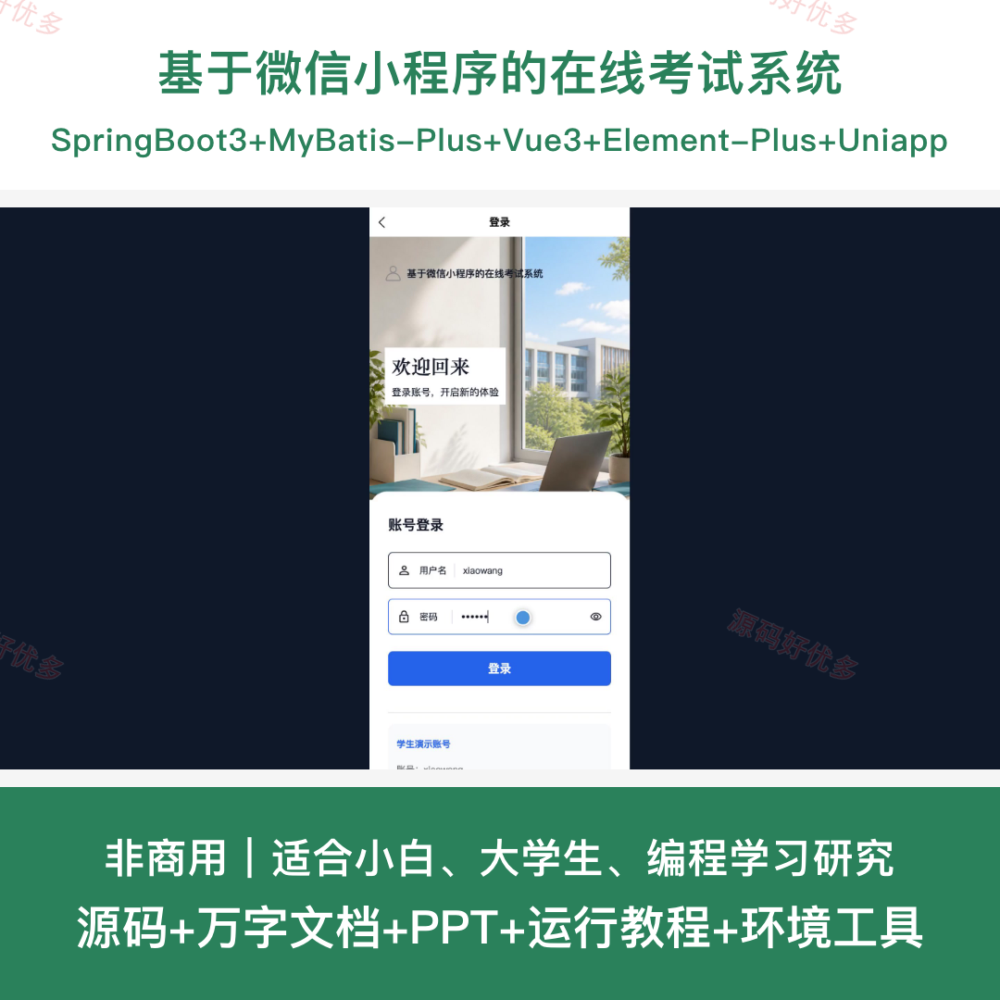
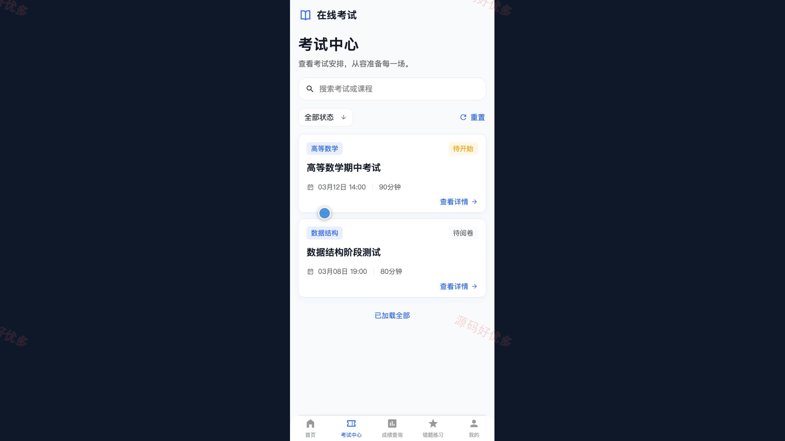
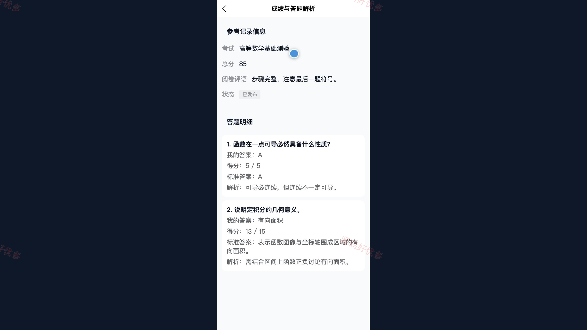
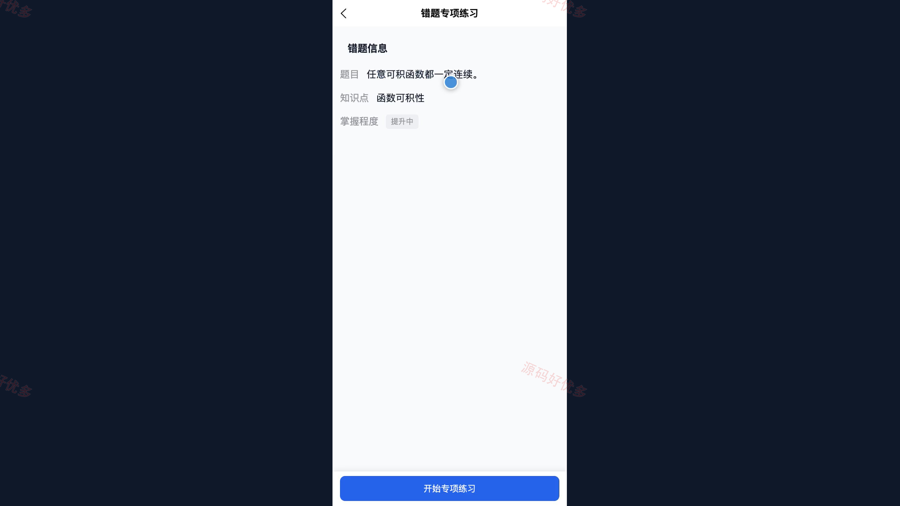
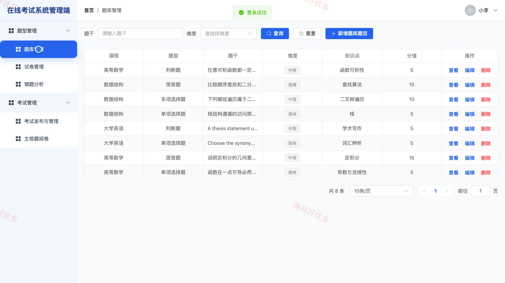
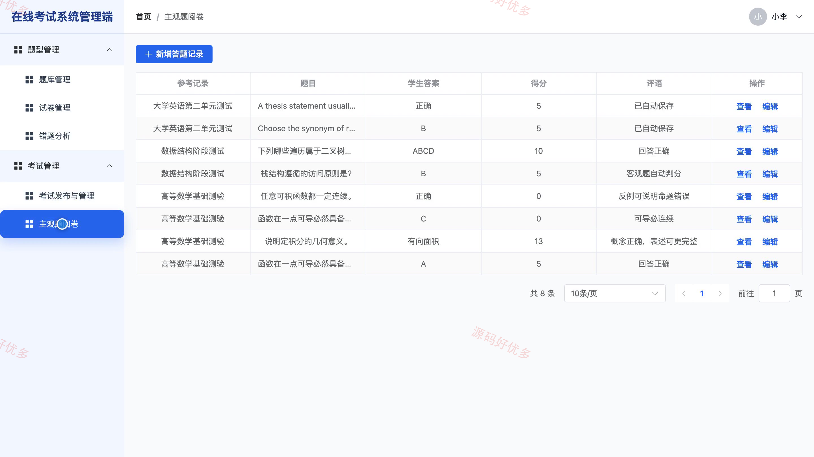
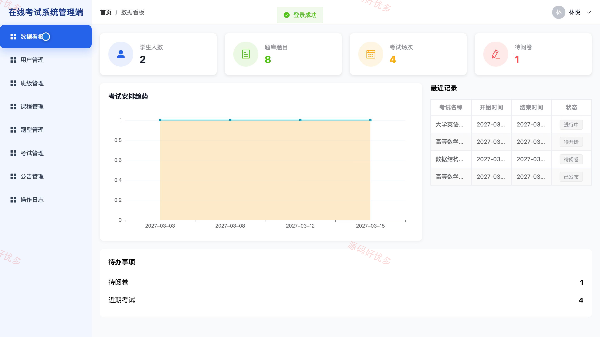

# bs008B
bs008B基于微信小程序的在线考试系统源码JavaSpringBoot3Vue3文档PPT
## 源码问题查看主页咨询

### 一、关键词
在线考试、试卷组卷、在线答题、成绩查询、错题练习、考试统计

### 二、作品包含
源码+数据库+万字设计文档+PPT+全套环境和工具资源+本地部署教程

### 三、项目技术
前端技术： Html、Css、Js、Vue3.4、Element-Plus、uniapp
后端技术：Java、SpringBoot3.2.0、MyBatis-Plus

### 四、运行环境要求
开发工具：IDEA/eclipse + VSCODE + HBuilder X + 微信开发者工具

数据库：MySQL5.7+（共16张表）

数据库管理工具：Navicat10以上版本

环境配置软件： JDK17 + Maven3.6

前端Nodejs：20

浏览器：谷歌浏览器

### 五、项目介绍
项目编号：bs008B

本项目面向学校在线考试场景，学生通过微信小程序查看可参加考试、在线答题与交卷、查询成绩及解析，并利用错题本开展专项练习；教师在 Web 端维护题库和试卷、发布考试、监控参考状态、完成主观题阅卷与成绩发布；管理员负责账号、班级、课程、题型、考试、公告和操作日志管理。

角色：学生、教师、管理员

学生功能：账号登录、按课程和时间查看可参加考试、客观题与主观题在线作答及自动暂存、未答题检查与考试交卷、已发布成绩及各题得分查询、标准答案与题目解析查看、历史错题按课程分类复习、错题与题库知识点专项练习。

教师功能：课程题库维护、手动选题与规则抽题组卷、考试发布规则设置、学生参考状态监控、主观题阅卷、自动评分与人工评分复核及成绩发布、考试成绩统计、知识点高频错题分析。

管理员功能：学生与教师账号及启用状态管理、班级信息与学生所属班级管理、课程资料与授课教师配置、考试题型管理、全校考试安排查看与异常记录处理、考试通知与系统公告管理、考试业务数据看板、重要管理操作日志查询。

### 六、运行截图

